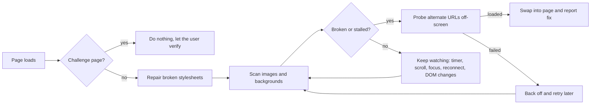

<div align="center">

# V3rmillion Loader

**Make [v3rmillion.net](https://v3rmillion.net) load completely, even on a flaky VPN or proxy.**


[Installation](#installation) · [Features](#features) · [How it works](#how-it-works) · [Troubleshooting](#troubleshooting) · [Changelog](#changelog)

</div>

---

## The problem

On a VPN or proxy, V3rmillion often loads only partway. The HTML arrives, but some of the files it needs don't:

| Symptom | Cause |
| --- | --- |
| Unstyled page | The main `/css.php?…` stylesheet request fails (status `0`) |
| Missing avatars, logo, icons | `user-assets.v3rm.net` returns random `403`s and network errors |
| Buttons and menus don't work | XenForo's JavaScript bundles never finish loading |

These failures are intermittent. Requesting the same file again usually works, and V3rmillion Loader does that for you.

## Features

- **Stylesheet repair:** finds stylesheets that are empty or failed, fetches them again with backoff, and inserts them into the page.
- **Image recovery:** retries failed images off-screen and swaps them in once they load, so nothing flickers. Retries rotate through the original URL, srcset entries and other avatar sizes, then cache-busted copies.
- **Continuous scanner:** re-checks the page every 2.5s, while you scroll, when you switch back to the tab, when the network reconnects and whenever new content appears. Lazy images near the screen are loaded early.
- **Script watchdog:** if XenForo's JavaScript didn't start, the page is reloaded once. A guard prevents reload loops.
- **Popup dashboard:** a status card, per-page fix counts, an activity timeline and lifetime stats.
- **Respects Cloudflare and ad blockers:** it never touches Cloudflare challenges and never re-requests ads that Brave Shields or uBlock blocked.

## Installation

V3rmillion Loader isn't on the Chrome Web Store, so you install it as an **unpacked extension**. It takes about a minute.

### 1. Download the extension

**Option A: Download a ZIP (no Git needed)**

1. On this repo's GitHub page, click the green **Code** button, then **Download ZIP**.
2. Extract the ZIP somewhere permanent, such as `Documents\v3rmillion-loader`.

> [!IMPORTANT]
> Don't delete or move the folder after installing. The browser loads the extension straight from it.

**Option B: Clone with Git**

```bash
git clone https://github.com/ithinkimandrew/v3rmillion-loader.git
```

### 2. Load it into your browser

| Browser | Extensions page |
| --- | --- |
| Chrome | `chrome://extensions` |
| Brave | `brave://extensions` |
| Edge | `edge://extensions` |
| Opera / Vivaldi | `opera://extensions` / `vivaldi://extensions` |

1. Open the extensions page for your browser (copy the address from the table into the address bar).
2. Turn on **Developer mode** (a toggle in the top-right corner; in Edge it's in the left sidebar).
3. Click **Load unpacked**.
4. Select the folder that contains `manifest.json`. If you downloaded the ZIP, that's the inner `v3rmillion-loader-main` folder.
5. **V3rmillion Loader** now appears in your list of extensions.

### 3. Pin it (recommended)

Click the puzzle-piece icon in the toolbar, then the pin next to **V3rmillion Loader**. The icon's badge then shows how many fixes were applied to the current page.

### 4. Use it

Browse [v3rmillion.net](https://v3rmillion.net) as usual. There's nothing to configure. Click the toolbar icon whenever you want to see what was repaired.

### Updating

- **ZIP:** download the new ZIP, replace the contents of your folder, then click the reload icon (↻) on the extension's card on the extensions page.
- **Git:** run `git pull` in the folder, then click the reload icon (↻).

Your lifetime stats are kept when you update.

### Uninstalling

Click **Remove** on the extension's card on the extensions page, then delete the folder.

## The popup

Click the toolbar icon to see:

- **Status card:** shows at a glance whether the page *loaded cleanly*, had *fixes applied* or is waiting on a *Cloudflare check*.
- **This page:** tiles for styles, images and reloads, a warning for anything that couldn't be recovered, and an expandable activity timeline.
- **Lifetime:** a ring chart showing what share of pages needed a repair, plus totals for pages, images, styles, reloads and Cloudflare checks.
- **Compact layout:** fits Chrome's 600px popup limit. If the activity list grows long, only the list scrolls (no scrollbars, just a soft fade at the bottom).
- **Quick actions:** a button to reload the current page and a two-step *Reset stats* (click twice).
- **Badge:** the number of fixes on the current tab. `!` means a Cloudflare check is waiting for you.

## How it works



## Project structure

```
v3rmillion-loader/
├── manifest.json   # MV3 manifest
├── background.js   # Service worker: per-tab state, lifetime stats, badge
├── content.js      # Repairs stylesheets, images and scripts on v3rmillion.net
├── content.css     # Placeholder for unrecoverable images and the in-page banner
├── popup.html      # Toolbar popup
├── popup.css
└── popup.js
```

## Troubleshooting

| Problem | Fix |
| --- | --- |
| "Manifest file is missing or unreadable" | You picked the wrong folder. Select the one that directly contains `manifest.json`. |
| The extension vanished after a restart | The folder was moved or deleted. Put it back and load it again. |
| No badge or stats | Pin the extension, then reload the v3rmillion.net tab. |
| Some images stay grey | Those files are being refused upstream every time. The popup lists them as *unrecoverable*. |
| A "Just a moment…" page keeps showing | That's Cloudflare verification. Complete it yourself, or switch VPN server or turn on split tunneling for this site. |

To see every repair as it happens, open DevTools on v3rmillion.net and filter the console for `[V3rmillion Loader]`.

## Privacy

- Runs only on `v3rmillion.net` and `v3rm.net`.
- Stats are stored locally with `chrome.storage`. Nothing is sent anywhere.
- It only re-requests the site's own files from the site's own servers.

> [!NOTE]
> V3rmillion Loader doesn't solve or skip Cloudflare challenges. If your VPN's IP range is hard-blocked, switch servers or turn on split tunneling for this site.

## Contributors

| | |
| --- | --- |
| **[@ithinkimandrew](https://github.com/ithinkimandrew)** | Author and maintainer |
| **Claude** (AI pair programmer) | Diagnostics, repair engine, popup UI, docs |

## Changelog

### 1.3.1
- Fixed the popup growing a page scrollbar when the activity card is opened. The header and footer stay put, the activity list scrolls on its own with a fade instead of a scrollbar, and the layout is slightly more compact.

### 1.3.0
- Redesigned the popup: status card at the top, per-page tiles, an expandable activity timeline with icons, a lifetime ring chart, a reload button and a two-step stats reset.
- Rewrote the README with an installation guide and a troubleshooting section.

### 1.2.1
- Stubborn images are probed off-screen and swapped in only once they load (no flicker).
- Retries rotate through the exact original URL (can be served from Cloudflare's cache), srcset entries and other avatar sizes (s/m/l), then cache-busted copies.
- Retries no longer freeze when the Brave window is covered by another window. Switching back to the tab retries right away.

### 1.2.0
- Added a continuous scanner: periodic, scroll, visibility, reconnect and DOM-mutation triggered.
- Images that stall are re-requested, and lazy images near the viewport load right away.
- Visible images keep retrying every 30s after the fast phase.
- Inline background images and stylesheets added later are repaired too.

### 1.1.0
- Added the popup dashboard with per-page mitigations and lifetime stats.
- Added a toolbar badge showing the fix count for the current tab.

### 1.0.0
- First release: stylesheet repair, image retry, script watchdog, Cloudflare-safe behavior.
