<a id="top"></a>

<div align="center">


<br>


**Make [v3rmillion.net](https://v3rmillion.net) load completely, even on a flaky VPN or proxy.**

[The problem](#the-problem) · [Features](#features) · [Installation](#installation) · [The popup](#the-popup) · [Settings](#settings) · [How it works](#how-it-works) · [Project structure](#project-structure) · [Troubleshooting](#troubleshooting) · [Privacy](#privacy) · [Changelog](#changelog)

</div>


<a id="the-problem"></a>

On a VPN or proxy, V3rmillion often loads only partway. The HTML arrives, but some of the files it needs don't:


| Symptom | Cause |
| --- | --- |
| Unstyled page | The main `/css.php?…` stylesheet request fails (status `0`) |
| Missing avatars, logo, icons | `user-assets.v3rm.net` returns random `403`s and network errors |
| Buttons and menus don't work | XenForo's JavaScript bundles never finish loading |

These failures are intermittent. Requesting the same file again usually works, and V3rmillion Loader does that for you.


<a id="features"></a>


| | Feature | What it does |
| :---: | --- | --- |
| **CSS** | Stylesheet repair | Finds stylesheets that are empty or failed, fetches them again with backoff, and inserts them into the page. |
| **IMG** | Image recovery | Retries failed images off-screen and swaps them in once they load, so nothing flickers. Retries rotate through the original URL, srcset entries and other avatar sizes, then cache-busted copies. |
| **SCAN** | Continuous scanner | Re-checks the page every 2.5s, while you scroll, when you switch back to the tab, when the network reconnects and whenever new content appears. Lazy images near the screen are loaded early. |
| **JS** | Script watchdog | If XenForo's JavaScript didn't start, the page is reloaded once. A guard prevents reload loops. |
| **UI** | Popup dashboard | A status card, per-page fix counts, an activity timeline and lifetime stats. |
| **CFG** | Settings and themes | Light, dark or automatic theme, a switch for each repair feature, and a one-click button to restore the recommended defaults. |
| **SAFE** | Respects Cloudflare and ad blockers | Never touches Cloudflare challenges and never re-requests ads that Brave Shields or uBlock blocked. |


<a id="installation"></a>

V3rmillion Loader isn't on the Chrome Web Store, so you install it as an **unpacked extension**. It takes about a minute.


### 1. Download the extension

**Option A: Download a ZIP (no Git needed)**

1. On this repo's GitHub page, click the green **Code** button, then **Download ZIP**.
2. Extract the ZIP somewhere permanent, such as `Documents\v3rmillion-loader`.

> [!IMPORTANT]
> Don't delete or move the folder after installing. The browser loads the extension straight from it.

**Option B: Clone with Git**

```bash
git clone https://github.com/ithinkimandrew/v3rmillion-loader.git
```

### 2. Load it into your browser

| Browser | Extensions page |
| --- | --- |
| Chrome | `chrome://extensions` |
| Brave | `brave://extensions` |
| Edge | `edge://extensions` |
| Opera / Vivaldi | `opera://extensions` / `vivaldi://extensions` |

1. Open the extensions page for your browser (copy the address from the table into the address bar).
2. Turn on **Developer mode** (a toggle in the top-right corner; in Edge it's in the left sidebar).
3. Click **Load unpacked**.
4. Select the folder that contains `manifest.json`. If you downloaded the ZIP, that's the inner `v3rmillion-loader-main` folder.
5. **V3rmillion Loader** now appears in your list of extensions.

### 3. Pin it (recommended)

Click the puzzle-piece icon in the toolbar, then the pin next to **V3rmillion Loader**. The icon's badge then shows how many fixes were applied to the current page.

### 4. Use it

Browse [v3rmillion.net](https://v3rmillion.net) as usual. There's nothing to configure. Click the toolbar icon whenever you want to see what was repaired.

<details>
<summary><b>Updating</b></summary>

<br>

- **ZIP:** download the new ZIP, replace the contents of your folder, then click the reload icon on the extension's card on the extensions page.
- **Git:** run `git pull` in the folder, then click the reload icon on the extension's card.

Your lifetime stats and settings are kept when you update.

</details>

<details>
<summary><b>Uninstalling</b></summary>

<br>

Click **Remove** on the extension's card on the extensions page, then delete the folder.

</details>


<a id="the-popup"></a>

<div align="center">
<table>
  <tr>
    <td align="center"><br><sub><b>Dark</b></sub></td>
    <td align="center"><br><sub><b>Light</b></sub></td>
  </tr>
</table>
</div>

The popup has two tabs, **Overview** and **Settings**. Overview shows:

- **Status card:** shows at a glance whether the page *loaded cleanly*, had *fixes applied* or is waiting on a *Cloudflare check*.
- **This page:** tiles for styles, images and reloads, a warning for anything that couldn't be recovered, and an expandable activity timeline.
- **Lifetime:** a ring chart showing what share of pages needed a repair, plus totals for pages, images, styles, reloads and Cloudflare checks.
- **Compact layout:** fits Chrome's 600px popup limit. If the activity list grows long, only the list scrolls (no scrollbars, just a soft fade at the bottom).
- **Quick actions:** a sun/moon button to switch between light and dark mode, a button to reload the current page, and a two-step *Reset stats* (click twice).
- **Badge:** the number of fixes on the current tab. `!` means a Cloudflare check is waiting for you.


<a id="settings"></a>

Open the popup and choose the **Settings** tab. Changes save instantly and are synced with your browser profile.

<div align="center">
</div>

| Setting | What it does | Default |
| --- | --- | :---: |
| Theme | **Auto** follows your system, or pick **Dark** or **Light** | Dark |
| Image recovery | Retries broken avatars, icons and attachments | On |
| Stylesheet repair | Fetches page styles again if they fail | On |
| Auto-reload | Reloads once if the site's scripts don't start | On |
| Preload nearby images | Loads lazy images before you scroll to them | On |
| Toolbar badge | Shows the fix count on the extension icon | On |
| In-page alerts | Shows a banner when something can't be fixed | On |

**Restore recommended defaults** at the bottom of the tab puts everything back to the values above. The button is greyed out while you're already using the defaults.


<a id="how-it-works"></a>


<details>
<summary><b>Image recovery, step by step</b></summary>

<br>

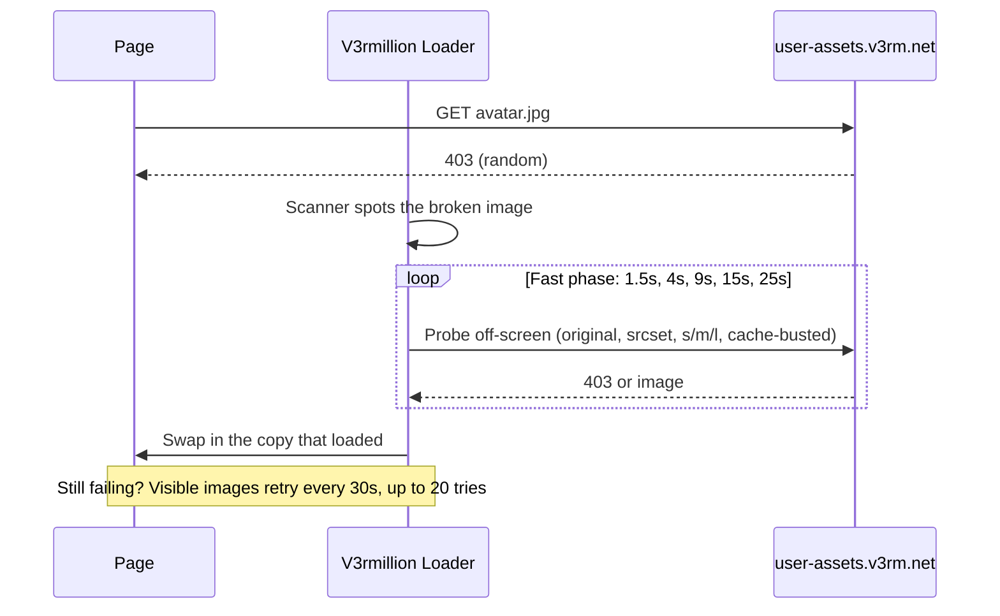

</details>

<details>
<summary><b>Life of a broken image</b></summary>

<br>

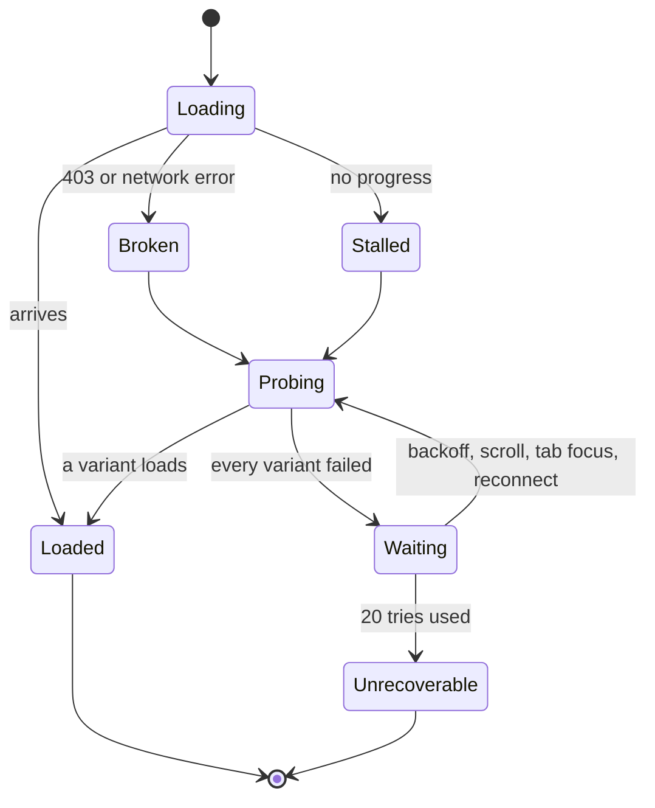

</details>


<a id="project-structure"></a>


<details>
<summary><b>Directory tree</b></summary>

<br>

```
v3rmillion-loader/
├── manifest.json       # MV3 manifest
├── background.js       # Service worker: per-tab state, lifetime stats, badge
├── content.js          # Repairs stylesheets, images and scripts on v3rmillion.net
├── content.css         # Placeholder for unrecoverable images and the in-page banner
├── popup.html          # Toolbar popup
├── popup.css
├── popup.js            # Overview + Settings tabs
├── theme.js            # Applies the light/dark theme before the popup paints
└── assets/             # README & forum graphics (not loaded by the extension)
    ├── headers/        # Animated section header banners
    └── thread/         # Animated V3rmillion forum release graphics
```

</details>


<a id="troubleshooting"></a>

Click a problem to see the fix.

<details>
<summary>"Manifest file is missing or unreadable"</summary>

<br>You picked the wrong folder. Select the one that directly contains `manifest.json`.
</details>

<details>
<summary>The extension vanished after a restart</summary>

<br>The folder was moved or deleted. Put it back and load it again.
</details>

<details>
<summary>No badge or stats</summary>

<br>Pin the extension, then reload the v3rmillion.net tab. Also check that **Toolbar badge** is on in the Settings tab.
</details>

<details>
<summary>Some images stay grey</summary>

<br>Those files are being refused upstream every time. The popup lists them as *unrecoverable*.
</details>

<details>
<summary>A "Just a moment…" page keeps showing</summary>

<br>That's Cloudflare verification. Complete it yourself, or switch VPN server or turn on split tunneling for this site.
</details>

<details>
<summary>Nothing gets repaired any more</summary>

<br>Open the Settings tab. If the Overview says *Repairs paused*, all repair switches are off; click **Restore recommended defaults**.
</details>

To see every repair as it happens, open DevTools on v3rmillion.net and filter the console for `[V3rmillion Loader]`.


<a id="privacy"></a>



- Runs only on `v3rmillion.net` and `v3rm.net`.
- Stats are stored locally with `chrome.storage`. Nothing is sent anywhere.
- Settings are saved with `chrome.storage.sync`, so they follow your browser profile if sync is on.
- It only re-requests the site's own files from the site's own servers.

> [!NOTE]
> V3rmillion Loader doesn't solve or skip Cloudflare challenges. If your VPN's IP range is hard-blocked, switch servers or turn on split tunneling for this site.


<a id="changelog"></a>

<details open>
<summary><b>1.4.0</b> (latest)</summary>

- Added a **Settings** tab: light, dark or automatic theme; switches for image recovery, stylesheet repair, auto-reload, preloading, toolbar badge and in-page alerts; and a *Restore recommended defaults* button.
- Added a light mode, plus a sun/moon quick toggle in the popup header.
- The badge setting applies to all open tabs immediately.
- Fixed the popup layout: the status card was squashed and the lifetime card was clipped behind the footer.
- New README with animated graphics, collapsible sections and diagrams.

</details>

<details>
<summary><b>1.3.1</b></summary>

- Fixed the popup growing a page scrollbar when the activity card is opened. The header and footer stay put, the activity list scrolls on its own with a fade instead of a scrollbar, and the layout is slightly more compact.

</details>

<details>
<summary><b>1.3.0</b></summary>

- Redesigned the popup: status card at the top, per-page tiles, an expandable activity timeline with icons, a lifetime ring chart, a reload button and a two-step stats reset.
- Rewrote the README with an installation guide and a troubleshooting section.

</details>

<details>
<summary><b>1.2.1</b></summary>

- Stubborn images are probed off-screen and swapped in only once they load (no flicker).
- Retries rotate through the exact original URL (can be served from Cloudflare's cache), srcset entries and other avatar sizes (s/m/l), then cache-busted copies.
- Retries no longer freeze when the Brave window is covered by another window. Switching back to the tab retries right away.

</details>

<details>
<summary><b>1.2.0</b></summary>

- Added a continuous scanner: periodic, scroll, visibility, reconnect and DOM-mutation triggered.
- Images that stall are re-requested, and lazy images near the viewport load right away.
- Visible images keep retrying every 30s after the fast phase.
- Inline background images and stylesheets added later are repaired too.

</details>

<details>
<summary><b>1.1.0</b></summary>

- Added the popup dashboard with per-page mitigations and lifetime stats.
- Added a toolbar badge showing the fix count for the current tab.

</details>

<details>
<summary><b>1.0.0</b></summary>

- First release: stylesheet repair, image retry, script watchdog, Cloudflare-safe behavior.

</details>



<div align="center">
<sub><a href="#top">Back to top</a></sub>
</div>
